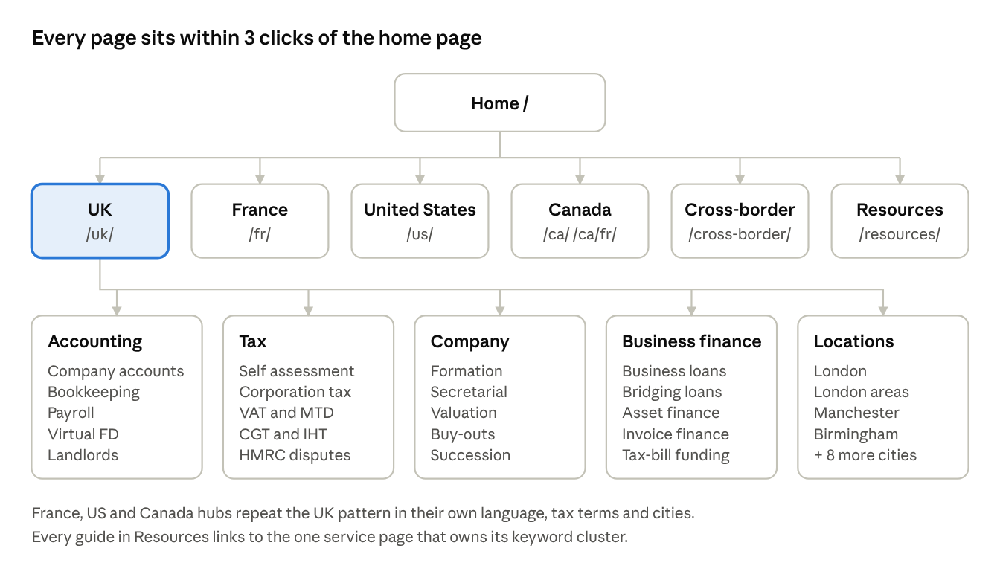
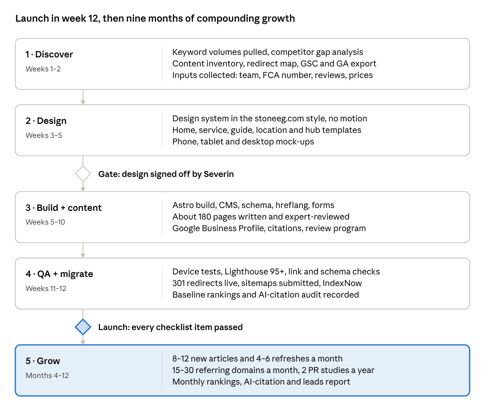

# Severin Finance — Website Rebuild & SEO/GEO Master Plan

Version 2.0 · 13 Oct 2026 (2.0: **UK only.** Severin is registered in the UK only, so the site offers UK work and names no other country. People abroad are reached through the UK services they need: non-resident tax, UK property, UK companies run from abroad. The France, US and Canada keyword lists are kept as research, marked "Out of scope". Earlier: 1.1 added Australia and the UAE; 1.2 dropped the UAE)

## Executive summary

We will rebuild the Severin Finance site as a static, near-zero-JavaScript website with one page per service. It will be designed to rank in Google and Bing and to be cited by AI answer engines (ChatGPT, Perplexity, Google AI Overviews, Gemini, Claude). No one can guarantee position 1 for every search. This plan targets the 400+ highest-intent searches in the UK, plus the UK searches people abroad make (non-resident tax, UK property, UK companies run from abroad), and builds the authority needed to win them.

**Business:** Severin Finance, an accounting and lending firm headquartered in London. It is registered in the UK only and does UK work only: for clients across the UK, and for people and companies abroad with UK tax or a UK company.

**Goals**

1. **Traffic:** grow organic visits to 10,000/month by month 12 and 30,000/month by month 24. These are planning targets, to be re-set after the baseline audit.
2. **Leads:** a 3–5% visitor-to-enquiry rate on service pages, with a consultation form on every page.
3. **Visibility:** top 3 in Google for 50+ commercial keywords, plus citation in AI answers for core questions ("best accountant in London for small business", "how to set up a UK company from abroad").
4. **Speed:** every page passes Core Web Vitals on mobile. LCP under 1.8 s, INP under 100 ms, CLS under 0.05. Home page under 300 KB in total.
5. **Reliability:** pixel-perfect layout from 320 px phones up to 1920 px desktops. No animations, no layout shift, no pop-ups.

**Scope**

- One country: the UK (`/uk/`), London first. No other country is named on the site, because Severin is not registered outside the UK.
- **Clients abroad** (`/cross-border/`): UK services for people and companies outside the UK (non-resident UK tax, UK company from abroad, non-resident landlords, UK property sales). These pages rank for searches made from any country, without naming one.
- Every service gets one page. London and its areas, then major UK cities, get location pages: London, Manchester, Birmingham, Leeds, Bristol and others.
- A resource hub with guides, tax calendars, calculators and glossaries. This is the traffic engine and the main source of AI citations.
- A backlink, digital PR and local SEO program that runs every month from launch.

## Current website audit (severinfinance.com)

The current site can't rank at scale. It has 12 indexed pages, no country or lending pages, no meta descriptions, and a 2.3-second server response. It is a rebuild, not a refresh. Audited on 9 Oct 2026 from the live HTML, robots.txt and sitemap.

| Area | What we found | Impact | Fix in the new site |
| --- | --- | --- | --- |
| Platform | WordPress 7.1 + Elementor Pro 4.3 + Astra theme. The child theme is named "camille-nedjar-child", left over from another client's build | Heavy, slow, fragile | Static site (Astro), see Performance section |
| Server speed | Time to first byte is 2.3–2.4 s on 3 tests (Google's "good" is under 0.8 s). Apache, no CDN, `cache-control: must-revalidate` | Fails Core Web Vitals on mobile | Global CDN edge hosting, TTFB under 100 ms |
| Page weight | 175 KB of HTML alone, 18 script files, 33 stylesheets on the home page | Slow on 4G phones | Under 300 KB total, under 15 KB JS |
| Pages | 12 URLs in the sitemap: home, `/home/`, `/home-francais/`, about, who-we-are, services + 4 service pages, contact, 2 legal pages | Far too few to rank for 400+ keywords | About 180 pages at launch, 400+ by month 12 |
| Lending | No lending or loan page anywhere | Zero visibility for business loan searches | Full UK lending section |
| Clients abroad | One old `/home-francais/` page, and nothing for clients outside the UK | No visibility for "UK tax from abroad" searches | Clients abroad section: UK services for non-residents, no other country named |
| Title tags | Home title is just "Severin Finance" | No keyword targeting | Unique, keyword-led title on every page |
| Meta descriptions | None | Lower click-through | Hand-written for every page |
| Headings | No clear H1. Slogans and card labels share heading levels | Google can't tell the page topic | One H1 per page, logical H2/H3 |
| Duplicate copy | The same sentence repeats on 3–4 service cards. "Tax Refund", "Late Returns" and "Tax Disputes" all link to Company Accounts | Thin content, wrong page signals | One dedicated page per service |
| Content depth | About 400–450 unique words on the services page, no blog, no guides | No informational traffic, nothing for AI to cite | 1,200–2,500 words per service page + resource hub |
| Typos | "bookkeepeing", "Serverin Finance", "I can only recommended" | Hurts trust (YMYL) | Proofread and style guide |
| Trust signals | Calls itself a "Chartered Management Accountant Practice" but names no team, qualifications, regulator or years in business | Weak E-E-A-T for a finance site | Team bios, CIMA/regulator badges, reviews |
| Schema | Yoast's basic WebPage/Organization only, `inLanguage: en-US` on a UK firm | No rich results | AccountingService, LocalBusiness, FAQ, Article, Person, Breadcrumb |
| robots.txt | `Crawl-delay: 10` for all bots | Bing (which powers ChatGPT search) crawls slowly | Remove the crawl delay, allow AI crawlers |
| Mixed content | Logo and schema images load over `http://` | Browser warnings, wasted redirects | HTTPS only |
| Booking | The main call to action goes to an external booking link | Lost conversions and tracking | On-site form + embedded booking, tracked |
| Images | 6 images on home, 3 with empty alt text, unoptimised stock JPEGs | Slow load, no image SEO | AVIF/WebP, sized, descriptive alt text |

**Keep:** the domain severinfinance.com (its age and existing links), the phone number 020 4542 2488, the email, the "single point of contact" promise, and the slogan "Simplifying the complex, so that everything is just black and white." That line is a strong brand anchor for the new design.

**Inputs needed from you before design starts**

- [ ] Reference website URL (the design you like). The design section below is waiting for it
- [ ] Full list of lending products (business loans, bridging, commercial mortgages, asset or invoice finance?) and whether Severin lends directly or brokers
- [ ] FCA firm reference number (required on any UK lending page)
- [ ] Team names, photos and qualifications (CIMA, ACCA, ICAEW, CTA)
- [ ] Office or registered addresses in each country (needed for Google Business Profiles)
- [ ] Real reviews or testimonials, client logos and case studies
- [ ] Google Search Console and Analytics access (to export current rankings and links before migration)
- [ ] Pricing or "from" prices per service (price pages rank and convert well)

## Design direction and design system

We will copy the look of [stoneeg.com](https://stoneeg.com/): oversized Swiss-style type, alternating black and white sections, rounded cards and pill buttons. We will drop all of its motion. It is a close match for Severin's "black and white" brand line. Reference analysed on 9 Oct 2026 from its live HTML and its 141 KB stylesheet.

**What we take from the reference**

| Element | stoneeg.com | Severin Finance version |
| --- | --- | --- |
| Typeface | Suisse Intl (commercial, by Swiss Typefaces), with Manrope as fallback | Option A: license Suisse Intl webfonts. Option B (free): Inter Tight or Manrope. One family only |
| Weights | Mostly 500, with 400 for body text | 400 and 500 only: 2 WOFF2 files, about 40 KB in total |
| Type scale | Display headings at about 90 px (9rem); section titles 32–45 px; body 16–20 px; tight letter spacing (-0.01 to -0.05em) on large type | Same scale, fluid with `clamp()`. The hero heading is 40 px on phones and 88 px on desktop |
| Labels | Small uppercase eyebrow labels with wide spacing (0.2em) | Same, e.g. "ACCOUNTING · UK" above each H1 |
| Colour | Black `#000`, white `#fff`, off-white `#f1f3fa`, mint `#e3f5f3`, green `#33b47b`, red `#eb4242` | Black, white, off-white panels, one accent (green fits finance), red for form errors only |
| Sections | Alternating white and black ("-inverse") full-width bands | Same rhythm: white hero, black stats band, white services, black FAQ, and so on |
| Shapes | Card radius 16–20 px, pill buttons, round avatars | Same |
| Breakpoints | Mobile-first: 360, 768, 1000, 1200 and 1600 px | Same breakpoints (table below) |
| Motion | reveal.js, counters.js, hero.js, feature-stack.js, a custom cursor, 0.4–2 s transform transitions, Wistia video player | **All removed.** Static content, colour-only hover states |
| Weight | 10 script files + a 141 KB stylesheet | 0–2 tiny scripts, under 20 KB of CSS |

**Home page section map (reference → Severin)**

1. **Top banner** (their investor-risk notice) → slim regulatory strip on lending pages: "Severin Finance is authorised and regulated by the FCA, FRN xxxxx".
2. **Big intro headline** → "Simplifying the complex, so that everything is just black and white." plus a one-line offer, with 2 buttons: Book a free consultation, and Call 020 4542 2488.
3. **Showreel video** → one static, compressed photo of the team or office. No video on load.
4. **By the numbers: 6 stat blocks** → years in practice, clients served, 4 countries, tax saved or refunded, Google rating, reply time. Static numbers, no counting animation.
5. **Feature block ("Built in America")** → "Accounting and lending under one roof" with an Explore button.
6. **Three cards (Investment Materials)** → three service pillars: Accounting & Tax, Business Lending, Cross-border. Each card links to its hub.
7. **Leadership: 3 profile cards** → team cards with photo, qualifications and LinkedIn. Strong E-E-A-T.
8. **Video assets list** → latest guides and tax-deadline articles from the resource hub.
9. **Testimonials grid** → text reviews with names and Google or Trustpilot stars, marked up with Review schema.
10. **FAQ on a black band** → 8–10 questions using native `
`, so it needs no JavaScript and every answer is crawlable.
11. **Closing CTA** with 3 stats and a button → "Ready to make your finances black and white?" plus the form.
12. **Legal disclosures block** → company number, registered office, FCA/ICO numbers, lending risk warnings.
13. **Footer** → logo, address per country, service links, country links, legal links.

**Design rules (apply whatever the reference)**

1. **No animation of any kind.** No fade-ins, sliders, carousels, parallax, counters, hover zooms or loading spinners. Hover only changes colour or underline. Nothing moves, so nothing shifts and nothing breaks on low-end phones.
2. **Fonts:** 1 family and 2 font files in total, self-hosted as WOFF2 and subset to Latin. `font-display: swap` with size-matched fallbacks, so text never jumps. Following the reference, one sans family (Suisse Intl or Inter Tight) carries headings and body.
3. **Colour:** near-black `#111`, white, one brand accent for buttons and links, one muted grey for secondary text. WCAG AA contrast (4.5:1) everywhere.
4. **Type scale:** body text 17–18 px on mobile and 18 px on desktop, line height 1.6, max line length 70 characters. Headings use fluid `clamp()` sizes, so one design fits every screen.
5. **Spacing:** an 8 px grid. Section padding is 48 px on mobile, 72 px on tablet and 96 px on desktop.
6. **Images:** real team and office photos over stock. Every image has fixed width and height (no layout shift), AVIF with a WebP fallback, and lazy loading below the fold. Icons are inline SVG, not an icon font.
7. **Buttons and forms:** minimum 48 px tap targets, a visible focus ring, labels above fields, and one primary action per section.
8. **Trust visible above the fold:** rating stars with review count, accreditation logos, and the FCA number on lending pages.

**Breakpoints**

| Device | Width | Layout |
| --- | --- | --- |
| Small phone | 320–359 px | 1 column, sticky bottom "Call / Book" bar |
| Phone | 360–767 px | 1 column, 2-up stat blocks |
| Tablet | 768–999 px | 2 columns, condensed nav |
| Laptop | 1000–1199 px | 3-column grids, full nav with dropdown |
| Desktop | 1200–1599 px | 3–4 column grids, content capped at 1200 px |
| Large desktop | 1600 px + | Larger display type, wider margins, same grid |

We will test on real devices (iPhone SE, iPhone 15, a mid-range Android, iPad, iPad Pro, a 13" laptop, a 27" monitor) and in Chrome, Safari, Firefox and Edge before launch.

## Markets, audiences and search intent

Severin is registered in the UK only, so the site has one market and names no other country.

| Market | Language and URL | Tax / company authority | Words people search | Rules to respect |
| --- | --- | --- | --- | --- |
| United Kingdom | English (en-GB), `/uk/` | HMRC, Companies House | accountant, self assessment, corporation tax, VAT return, bookkeeper, business loan | FCA rules on financial promotions and credit broking. Use "chartered" only for the actual body (e.g. CIMA) |

**Reaching people abroad without naming other countries**

- Write for the UK need, not the country: "UK tax return while living abroad", "non-resident landlord", "sell UK property from abroad", "UK company for non-residents", "tax refund after leaving the UK". People search these from every country, and they rank without a country name.
- Use the words people abroad search for: abroad, overseas, non-resident, expat, leaving the UK, moving back to the UK.
- Do the UK side only. Never offer advice or filing in another country, never name a foreign tax authority or partner firm, and never promise to sort out "both countries". Saying that UK treaty relief stops the same income being taxed twice is fine: it is a UK claim.
- One English (en-GB) version of each page: no hreflang, no country pages, no geo-redirects. Google ranks an English .com page anywhere.
- Schema `areaServed` stays United Kingdom (plus London). It describes where the service is provided, not where clients live.

**Who we are writing for (priority order)**

1. **UK small businesses and sole traders:** limited companies, contractors, landlords, start-ups. The biggest volume and the home market.
2. **Clients abroad with UK affairs:** Britons who have moved abroad, non-resident landlords, people selling UK property from abroad, and founders running a UK company from outside the UK. UK work only.
3. **SMEs needing finance:** business loans, cash-flow funding, asset finance, alongside their accounts.

**Search intent we cover on every topic**

| Intent | Example search | Page type that wins it |
| --- | --- | --- |
| Transactional ("hire now") | accountant for limited company London | Service × location page with price and form |
| Commercial ("compare") | best online accountant UK, accountant fees UK | Pricing page, comparison guide |
| Informational ("learn") | how to file self assessment late | Guide in the resource hub, linking to the service |
| Navigational / local ("near me") | accountant near me, accountant London | Google Business Profile + city page |
| AI / conversational | "I've moved abroad, who can still do my UK tax return?" | Clients abroad pages with clear Q&A blocks |

## Master keyword list

We will target about 450 keywords in 4 markets, grouped into clusters. Each cluster has one page that owns it, so no two pages compete. In week 1 every keyword is pulled into Semrush or Ahrefs and Google Keyword Planner to get its monthly volume, difficulty and CPC. Priorities below are then re-ranked by volume × intent ÷ difficulty.

**Priority key:** P1 = build at launch · P2 = months 1–4 · P3 = months 4–12.

The working list, one row per keyword with empty columns for volume, difficulty, CPC and rank, is in [research/keywords/keyword-master.csv](../research/keywords/keyword-master.csv). It had 335 seed keywords at v1.0. On 9 Oct the pasted 6-country research took it to 667, with 85 Italy/Australia candidates on hold in a separate file (see [the merge notes](../research/keywords/pasted-research-2026-10-09.md)). It includes city variants and will grow again after the week-1 tool pulls.

### United Kingdom (en-GB)

| Cluster | Keywords (and close variants) | Intent | Target page | Priority |
| --- | --- | --- | --- | --- |
| Accountant – general | accountant London, accountants in London, accountancy firm London, chartered accountant London, small business accountant London, accountant near me, online accountant UK, affordable accountant London | Transactional | `/uk/` hub + `/uk/london/` | P1 |
| Limited companies | accountant for limited company, limited company accounts, year end accounts, annual accounts Companies House, dormant company accounts, confirmation statement filing | Transactional | `/uk/accounting/limited-company-accountant/` | P1 |
| Sole traders & self assessment | self assessment accountant, self assessment tax return help, sole trader accountant, tax return accountant London, late self assessment, HMRC late filing penalty help | Transactional | `/uk/tax/self-assessment-accountant/` | P1 |
| Making Tax Digital | Making Tax Digital accountant, MTD for income tax, MTD software help, MTD for landlords, quarterly updates HMRC | Transactional + info | `/uk/tax/making-tax-digital-accountant/` | P1 |
| Corporation tax | corporation tax accountant, corporation tax return CT600, corporation tax planning, R&D tax credits accountant | Transactional | `/uk/tax/corporation-tax-accountant/` | P1 |
| VAT | VAT accountant, VAT return services, VAT registration, VAT threshold, flat rate VAT scheme, VAT for e-commerce | Transactional | `/uk/tax/vat-accountant/` | P1 |
| Bookkeeping & payroll | bookkeeping services London, bookkeeper London, online bookkeeping UK, Xero bookkeeper, QuickBooks bookkeeper, payroll services London, payroll bureau, auto enrolment pension | Transactional | `/uk/accounting/bookkeeping-services/`, `/uk/accounting/payroll-services/` | P1 |
| Management & FD | management accounts, outsourced finance director, virtual FD London, part-time CFO UK, cash flow forecasting | Transactional | `/uk/accounting/virtual-finance-director/` | P2 |
| Personal tax | capital gains tax accountant, CGT on property sale, inheritance tax planning, inheritance tax accountant London, tax refund UK, tax rebate, prior year tax returns | Transactional | `/uk/tax/capital-gains-tax-accountant/`, `/uk/tax/inheritance-tax-planning/`, `/uk/tax/tax-refunds/` | P1 |
| Property | landlord accountant, property tax accountant London, buy-to-let tax, non-resident landlord scheme, property company (SPV) accounts | Transactional | `/uk/accounting/landlord-accountant/` | P2 |
| Contractors | contractor accountant, IR35 accountant, umbrella vs limited company | Transactional | `/uk/accounting/contractor-accountant/` | P2 |
| Tax disputes | HMRC tax investigation help, HMRC enquiry accountant, tax dispute resolution, HMRC penalty appeal, voluntary disclosure HMRC | Transactional | `/uk/tax/hmrc-tax-investigation/` | P1 |
| Company services | company formation London, register a limited company, company secretarial services, business valuation UK, management buy-out advice, business succession planning, EIS/SEIS advice | Transactional | `/uk/company-services/...` | P2 |
| Business lending | business loans UK, small business loans London, start-up business loans, secured business loan, unsecured business loan, business loan broker, working capital loan, business line of credit | Transactional | `/uk/business-finance/business-loans/` | P1 |
| Specialist finance | bridging loans, commercial mortgage, development finance, asset finance, equipment finance, invoice finance, invoice factoring, merchant cash advance | Transactional | one page each under `/uk/business-finance/` | P2 |
| Tax-bill funding | VAT loan, corporation tax loan, tax bill funding, pay HMRC in instalments | Transactional | `/uk/business-finance/tax-bill-funding/` (pairs accounting with lending, a rare angle) | P1 |
| Clients abroad | non-resident tax return UK, UK tax return from abroad, accountant for UK expats, non-resident landlord scheme, sell UK property as a non-resident, tax refund after leaving the UK, set up UK company from abroad, UK company for non-residents | Transactional | `/cross-border/...` | P1 |
| Pricing | how much does an accountant cost UK, accountant fees for limited company, self assessment accountant fees, bookkeeping prices | Commercial | `/uk/pricing/` | P1 |
| Guides (informational) | self assessment deadline, how to file a tax return, corporation tax rates, dividend tax rates, VAT threshold UK, sole trader vs limited company, how to pay yourself from a limited company, IR35 explained, what expenses can I claim, HMRC payment on account, how to get a business loan, business loan interest rates UK | Informational | `/resources/...` guides, each linking to its service | P1–P3 |

> **Out of scope (v2.0):** the France, US and Canada keyword lists below are research only. Severin is registered in the UK only, so these pages are not built.

### France (fr-FR)

| Cluster | Keywords | Intent | Target page | Priority |
| --- | --- | --- | --- | --- |
| Comptable France–UK (main edge) | expert-comptable Londres, comptable français à Londres, cabinet comptable franco-britannique, comptable pour expatriés Royaume-Uni, déclaration d'impôts expatrié Angleterre | Transactional | `/fr/londres/`, `/fr/expatries-royaume-uni/` | P1 |
| UK company for French founders | créer une LTD en Angleterre, créer une société au Royaume-Uni, comptabilité LTD anglaise, domiciliation Londres, fiscalité LTD résident français | Transactional | `/fr/creer-societe-royaume-uni/` | P1 |
| Comptabilité core | expert-comptable en ligne, cabinet comptable Paris, expert-comptable Paris, comptable pour TPE/PME, bilan comptable, liasse fiscale, comptabilité SASU, comptabilité SARL, comptable auto-entrepreneur / micro-entrepreneur | Transactional | `/fr/comptabilite/...` | P2 (check the title rules first) |
| Fiscalité | déclaration TVA, conseil fiscal entreprise, impôt sur les sociétés, convention fiscale France Royaume-Uni, non-résident impôt sur le revenu, plus-value immobilière non-résident, succession internationale | Transactional + info | `/fr/fiscalite/...` | P1–P2 |
| Financement | prêt professionnel, financement entreprise, prêt création entreprise, crédit-bail, affacturage, prêt de trésorerie | Transactional | `/fr/financement/...` | P2 |
| Tarifs | tarif expert-comptable, prix comptable SASU, combien coûte un expert-comptable | Commercial | `/fr/tarifs/` | P1 |
| Villes | expert-comptable Lyon, Marseille, Toulouse, Bordeaux, Nice, Lille, Nantes | Local | `/fr/<ville>/` (only with unique local content) | P3 |
| Guides | taux IS, date déclaration impôts, SASU ou EURL, rémunération dirigeant SASU, TVA intracommunautaire, quitter la France fiscalité, impôts expatrié Londres | Informational | `/fr/ressources/...` | P1–P3 |

### United States (en-US)

| Cluster | Keywords | Intent | Target page | Priority |
| --- | --- | --- | --- | --- |
| Expat & cross-border (main edge) | US expat tax UK, US tax return for Americans in London, FBAR filing, FATCA reporting, foreign earned income exclusion, US UK tax treaty, dual citizen taxes | Transactional | `/us/expat-tax/` | P1 |
| Foreign-owned US companies | form a US LLC from the UK, Form 5472 filing, foreign-owned LLC tax, ITIN application, EIN for non-residents, 1040-NR filing, US company for non-residents | Transactional | `/us/company-formation/`, `/us/non-resident-tax/` | P1 |
| Small business accounting | small business accountant, bookkeeping services for small business, outsourced bookkeeping, virtual accountant, accountant near me, business tax preparation, Form 1120 / 1120-S / 1065 filing, S corp election, sales tax compliance | Transactional | `/us/accounting/...`, `/us/tax/...` | P2 |
| Lending | small business loans, SBA loan help, equipment financing, business line of credit, invoice factoring, working capital loan | Transactional | `/us/business-finance/...` | P2 |
| Cities | accountant New York, NYC small business accountant, Miami, Los Angeles, Chicago, Houston, San Francisco, Boston | Local | `/us/<city>/` | P3 |
| Guides | tax deadline, quarterly estimated taxes, LLC vs S corp, how to file FBAR, Americans abroad taxes, US UK totalization agreement | Informational | `/us/resources/...` | P1–P3 |

### Canada (en-CA, fr-CA)

| Cluster | Keywords | Intent | Target page | Priority |
| --- | --- | --- | --- | --- |
| Cross-border (main edge) | Canadian tax accountant UK, Canada UK tax treaty, non-resident Canada tax return, leaving Canada departure tax, Canadians living in London taxes, NR4 / Section 216 return | Transactional | `/ca/canada-uk-tax/` | P1 |
| Corporate | corporate tax return T2, small business accountant Toronto, incorporate a business in Ontario, GST/HST return filing, payroll services Canada, bookkeeping services Toronto, Vancouver, Calgary | Transactional | `/ca/accounting/...`, `/ca/tax/...` | P2 |
| Quebec (fr-CA) | comptable Montréal, déclaration TPS/TVQ, impôt des sociétés Québec, comptable pour travailleur autonome | Transactional | `/ca/fr/...` | P3 |
| Lending | business loan Canada, equipment financing Canada, invoice factoring Canada, working capital loan Canada | Transactional | `/ca/business-finance/...` | P2 |
| Guides | CRA tax deadline, small business deduction, GST registration threshold, sole proprietor vs corporation Canada | Informational | `/ca/resources/...` | P2–P3 |

**City pages (UK first):** London plus 10–12 London areas (City of London, Canary Wharf, Westminster, Kensington, Camden, Islington, Shoreditch, Croydon, Wimbledon, Richmond, Stratford). Then Manchester, Birmingham, Leeds, Bristol, Liverpool, Reading, Cambridge, Oxford, Brighton and Milton Keynes. Each page needs real local content (local clients, meeting options, area-specific notes). Copy-and-swap city pages count as doorway pages under Google's spam policy and get demoted.

**Brand and entity terms:** Severin Finance, Severin Finance reviews, Severin Finance London, Severin accountants. These are owned through the home page, Google Business Profile, review sites and the About page.

## Site architecture and URLs

The site is a flat silo: Home → Country hub → Service category → Service → City variant. Every page is at most 3 clicks from the home page, and links flow up and across within each silo.

**URL rules**

- Lowercase, hyphenated, no dates, no IDs, trailing slash everywhere: `/uk/tax/self-assessment-accountant/`.
- The last part of a service URL is the page's main commercial keyword (`self-assessment-accountant`, `vat-accountant`, `bookkeeping-services`). Rules in [03-service-page-template.md](03-service-page-template.md).
- One canonical URL per page. HTTP, `www` and non-slash versions redirect (301) to it.
- Every old WordPress URL gets a 301 to its closest new page (map below). No old URL is left to 404.

**Launch page count (about 130)**

| Section | Pages at launch | By month 12 |
| --- | --- | --- |
| Core (home, about, team, each team member, reviews, contact, pricing, careers, legal) | 20 | 25 |
| UK services (accounting, tax, company services, business finance) | 35 | 45 |
| UK locations (London + areas + major cities) | 12 | 25 |
| Clients abroad (UK services for non-residents and UK companies run from abroad) | 4 | 10 |
| Resource hub (guides, glossary, tax calendars, calculators) | 50 | 200+ |
| Case studies | 6 | 20 |
| **Total** | **about 130** | **350+** |

**Redirect map from the current site**

| Old URL | New URL |
| --- | --- |
| `/` | `/` (new home) |
| `/home/` | `/` |
| `/home-francais/` | `/cross-border/uk-company-from-abroad/` |
| `/about-us/`, `/who-we-are/` | `/about/`, `/about/team/` |
| `/services/` | `/uk/` (services overview) |
| `/services/individual-and-sole-traders/` | `/uk/tax/self-assessment-accountant/` |
| `/services/company-accounts/` | `/uk/accounting/limited-company-accountant/` |
| `/services/specialized-accounting/` | `/cross-border/` |
| `/services/consulting/` | `/uk/accounting/virtual-finance-director/` |
| `/contact/` | `/contact/` |
| `/privacy-policy/`, `/cookie-policy-uk/` | `/legal/privacy/`, `/legal/cookies/` |

**Internal linking rules**

1. Every service page links up to its hub, across to 3–5 related services, and down to its city variants.
2. Every guide links to the one service page that owns its cluster in the first 150 words, using descriptive anchor text, never "click here".
3. Breadcrumbs on every page (also marked up as BreadcrumbList schema).
4. Header: **Services** (mega-menu: Accounting, Tax, Company services, Business finance, Cross-border, each with its sub-service pages; list in `site/src/data/services.js`) · **Locations** (mega-menu with every country and every targeted city/area page) · Pricing · Guides · About. A country picker sits top right. Location pages are planned in [02-location-pages-plan.md](02-location-pages-plan.md).
5. Footer: country hubs, top 12 services, top 8 cities, legal. No link farms.

## Page templates

The whole site is built from 9 templates and about 20 reusable sections from the stoneeg.com style. Every page of a type has the same proven structure, and only the words change.

| Template | Used for | Count at launch |
| --- | --- | --- |
| Home | `/` | 1 |
| Hub | `/uk/`, `/cross-border/` | 2 |
| Service | one per service | about 30 |
| Location | city and area pages | about 15 |
| Cross-border | country-pair pages | about 12 |
| Guide / article | resource hub | about 50 |
| Tool | calculators, tax calendar | 3–5 |
| Team member | one per adviser (E-E-A-T) | 4–8 |
| Utility | contact, pricing, reviews, legal | about 10 |

**Service page anatomy (top to bottom)**

1. Breadcrumb + uppercase eyebrow label ("TAX · UNITED KINGDOM").
2. **H1 with the main keyword**, e.g. "Self assessment accountants in London and across the UK".
3. **Answer-first summary (40–60 words):** what we do, for whom, the price "from", and turnaround. This is the paragraph AI engines quote.
4. Primary call to action (book / call), plus trust row: rating, reviews count, accreditations.
5. "Who this is for": 4–6 client types as cards.
6. "What's included": a checklist of deliverables.
7. "How it works": 3–4 numbered steps (static, no animation).
8. **Pricing table** with "from" prices or packages.
9. Key facts box: deadlines, thresholds and penalties for the current tax year, with the source linked (HMRC, IRS, CRA, impots.gouv).
10. Case study or mini client story with a real number.
11. Reviews filtered to this service.
12. Adviser box: photo, name, qualifications, "Reviewed by" date.
13. **FAQ: 6–10 questions** drawn from Google's "People also ask" and AI prompts, in `
` with FAQPage schema.
14. Related services + related guides.
15. Closing CTA band (black) + form.

**Guide anatomy:** H1 as a question or "how to", a TL;DR box with the direct answer, a table of contents, short sections with H2 questions, tables for rates and deadlines, sources cited inline, an author and reviewer box, last-updated date, a CTA to the owning service, and an FAQ.

**Contact and lead capture (on every page):** a short form (name, email, phone, country, service, message) posted to a serverless function, with honeypot + Cloudflare Turnstile against spam. Also click-to-call and WhatsApp links, and a booking link that opens on a separate page, so the booking script never slows other pages.

## Technical SEO checklist

Every item below is built into the templates, so each new page is correct by default. An automated check in the build fails any page that breaks a rule.

**On-page**

- [ ] Unique `<title>` of 50–60 characters: keyword first, brand last ("Self Assessment Accountant London | Severin Finance")
- [ ] Unique meta description of 140–155 characters with a benefit and a call to action
- [ ] Exactly one H1, with H2/H3 in logical order
- [ ] Self-referencing canonical tag on every page
- [ ] Open Graph + Twitter card tags with a 1200×630 share image per page
- [ ] Descriptive alt text on every image, and descriptive file names (`self-assessment-accountant-london.avif`)
- [ ] `lang` attribute set to `en-GB` on every page

**International**

- [ ] No hreflang: one language and one version of each page
- [ ] No automatic redirects by IP or browser language, so visitors and Googlebot (which crawls from the US) see the same page
- [ ] No other country named in copy, schema, menus or links (Severin is registered in the UK only)

**Structured data (JSON-LD)**

| Schema type | Where |
| --- | --- |
| Organization + AccountingService (a LocalBusiness subtype), with `sameAs` links to every profile | Site-wide / home |
| LocalBusiness per office or service area, with address, geo, opening hours | Location pages |
| Service + Offer (price) | Service pages |
| FinancialService / LoanOrCredit | Lending pages |
| FAQPage | Every FAQ block |
| Article + Person (author and reviewer) | Guides |
| BreadcrumbList | Every page |
| Review / AggregateRating (genuine, on-site reviews only) | Reviews page, service pages |
| HowTo-style steps, as plain HTML lists (Google no longer shows HowTo rich results) | Guides |
| WebSite | Home |

**Crawling and indexing**

- [ ] XML sitemaps per country and per content type, auto-generated, with `lastmod` from real content changes
- [ ] robots.txt with no crawl-delay. It allows Googlebot, Bingbot and AI crawlers (see GEO) and blocks only `/api/` and thank-you pages
- [ ] Submit to Google Search Console and Bing Webmaster Tools. IndexNow ping on every publish (Bing, Yandex, Naver, Seznam)
- [ ] No orphan pages: the build fails if a page has no internal links pointing to it
- [ ] Custom 404 page with search and top links. Zero broken links (checked in every build)
- [ ] Pagination and filters on the resource hub use clean, crawlable links, never infinite scroll

**Security and hygiene**

- [ ] HTTPS only, HSTS, modern TLS, security headers (CSP, X-Content-Type-Options, Referrer-Policy)
- [ ] Cookie banner that is GDPR/PECR compliant and loads no tracking before consent (Google Consent Mode v2)
- [ ] Accessibility at WCAG 2.2 AA: keyboard navigation, focus states, contrast, form labels. This is good for SEO, and expected under the Equality Act 2010

## GEO: getting cited by AI search

AI engines (ChatGPT, Perplexity, Google AI Overviews and AI Mode, Gemini, Copilot, Claude) cite pages that are easy to crawl, answer the question directly, and are confirmed by other trusted sites. The plan works on all three.

**1. Let AI crawlers in and give them clean HTML**

- robots.txt allows: Googlebot, Bingbot (Copilot, and the index behind ChatGPT search), OAI-SearchBot, ChatGPT-User, GPTBot, PerplexityBot, ClaudeBot, Claude-SearchBot, Claude-User, Google-Extended, Applebot and Applebot-Extended.
- All content is in the static HTML. Most AI crawlers don't run JavaScript, so anything injected by JS is invisible to them. Our static build avoids this by design.
- Publish `/llms.txt`: a plain-text map of the key pages with one-line summaries. It is cheap to add and is read by some AI tools.

**2. Write in the way AI engines quote**

- Open every page and every H2 with a 1–2 sentence direct answer, then the detail.
- Use question-shaped H2s that match how people ask ("How much does an accountant cost for a limited company in London?").
- Put numbers in tables (rates, thresholds, deadlines, prices), with the source and "as of" date. AI engines quote tables and specific figures far more often than adjectives.
- Each page covers one topic completely. Short, self-contained paragraphs can be lifted without context.
- Show the author and reviewer, their qualifications, and a "last reviewed" date on every page.

**3. Become a known entity**

- Use the exact same name, address and phone (NAP) on every profile: Google Business Profile, Bing Places, Apple Business Connect, LinkedIn, Companies House, Crunchbase, Trustpilot, Yell, Clutch.
- Organization schema with `sameAs` linking every profile. Create a Wikidata item once there is independent press coverage to cite.
- Get mentioned on the pages AI engines read for "best accountant in London": listicles, comparison sites, Reddit (r/UKPersonalFinance, r/smallbusinessuk, r/expats, r/AmerExit), Quora, and industry press. Answer as a named expert, without spam.
- **Publish original data once or twice a year.** For example, "UK Small Business Tax Pain Index 2027" or "What it costs to run a UK company from abroad". Unique statistics are what journalists and AI engines cite.

**4. Measure AI visibility monthly**

- A fixed list of 50 prompts per market ("best accountant in London for small business", "how to set up a UK company from abroad"), run monthly in ChatGPT, Perplexity, Gemini, Copilot and Google AI Mode. Record whether Severin is cited or mentioned.
- Tools to automate this: Semrush AI Toolkit, Ahrefs Brand Radar, Profound or Peec AI.
- In GA4, track AI referral traffic (chatgpt.com, perplexity.ai, gemini.google.com, copilot.microsoft.com, claude.ai) as its own channel.

## Content strategy and editorial calendar

We will publish 8–12 new pieces a month and refresh 4–6 existing ones. Timing follows each country's tax calendar, so each guide is live 6–8 weeks before searches for it peak.

**Content pillars**

| Pillar | Formats | Example titles |
| --- | --- | --- |
| Deadlines and rates (evergreen, refreshed yearly) | Tax calendars, rate tables, threshold pages | "UK Tax Deadlines 2026/27", "Corporation Tax Rates 2026" |
| How-to guides | Step-by-step guides with screenshots | "How to File a Late Self Assessment", "How to Register for VAT", "How to File a UK Tax Return from Abroad" |
| Decisions | Comparisons, "X vs Y" | "Sole Trader vs Limited Company", "UK Branch or UK Subsidiary?" |
| Clients abroad | UK-side explainers | "UK Tax When You Move Abroad: Checklist", "Selling UK Property as a Non-Resident" |
| Finance | Lending explainers, rate guides | "Business Loan Rates UK 2026", "Invoice Finance vs Overdraft" |
| Tools | Calculators (static HTML + a few lines of JS, only on that page) | Take-home pay, dividend vs salary, VAT, corporation tax, loan repayment |
| Proof | Case studies, original surveys | "How a café owner in London cut tax by £12,400" (real numbers, with permission) |
| Glossary | One short page per term | "What is a UTR?", "What is a CT600?", "What is the Non-Resident Landlord Scheme?" |

**Seasonal calendar (when to publish and refresh)**

| Month | UK |
| --- | --- |
| Oct–Nov | Self assessment push (31 Jan deadline), MTD readiness |
| Dec–Jan | Self assessment peak, late-filing pages |
| Feb–Mar | Tax year end (5 April), dividends, ISA, pensions |
| Apr–May | New tax year rates, P60s |
| Jun–Sep | MTD quarters, payments on account (31 July) |

**Quality standards (YMYL: "Your Money or Your Life" topics get extra scrutiny from Google)**

1. Every piece is written or reviewed by a qualified adviser, who is named on the page.
2. Figures are cited to the official source (GOV.UK, HMRC manuals, legislation.gov.uk, Companies House, the Bank of England), with an "as of" date.
3. AI tools may help draft, but every page gets a human expert edit, original examples and real client insight. Mass-produced, unedited AI text is an explicit target of Google's spam policies.
4. Rate and deadline pages are reviewed every Budget and every 6 months. The page's "last updated" date is shown and changed only when the content changes.

## Backlinks, digital PR and local SEO

Ready-to-use copy, lists and templates for everything in this section: [docs/04-off-page-and-local-seo.md](04-off-page-and-local-seo.md).

Target 15–30 quality referring domains a month, all earned through relevance. No bought links, private blog networks or link exchanges. On a finance site these risk a Google manual penalty that can wipe out rankings for months.

**Link sources, from easiest to hardest**

| Tactic | Targets | Links per month |
| --- | --- | --- |
| Citations and directories | Google Business Profile, Bing Places, Apple Business Connect, Yell, Thomson Local, Scoot, FreeIndex, Clutch, Trustpilot, Crunchbase | 10–20 at setup, then upkeep |
| Software partner directories | Xero Advisor Directory, QuickBooks ProAdvisor, FreeAgent, Sage, Dext | 4–6 total |
| Professional bodies and chambers | CIMA member directory, British Chambers of Commerce, London Chamber of Commerce | 1–2 |
| Expert commentary | Answer journalist requests via Qwoted, Featured, ResponseSource (UK), #journorequest on X, Source of Sources. Topics: Budget day, deadlines, tax changes | 3–8 |
| Data-led digital PR | 2 original studies a year (survey of 500 SMEs, regional tax burden map, "cost of an accountant by city") pitched to UK and expat press | 20–60 per campaign |
| Guest articles | Expat sites, start-up blogs, accounting and fintech blogs. One expert article a month, real value, no spun content | 1–2 |
| Partnerships | Banks, lenders, solicitors, estate agents, relocation firms, co-working spaces and start-up accelerators. Mutual "recommended partners" pages and co-written guides | 1–3 |
| Linkable tools | Free calculators and the tax calendar. Pitch them to resource pages at universities, business schools and councils | 2–4 |
| Reclamation | Unlinked brand mentions, broken links pointing to dead competitor pages (replace them with our guide) | 1–3 |
| Podcasts and events | Guest on founder, expat and finance podcasts. Speak at chamber and co-working events | 1–2 |

**Anchor text mix (natural profile):** about 50% brand or URL, 25% generic ("this guide", "here"), 15% partial match ("accountant for UK expats abroad"), and under 10% exact match.

**Local SEO**

1. One Google Business Profile per real staffed address only. Category "Accountant" (primary) plus "Tax preparation service", "Bookkeeping service" and "Financial consultant". A virtual office address risks suspension, so if clients do not visit the office, use a service-area setup with the address hidden.
2. Fill every field: services with descriptions, opening hours, photos (team, office, not stock), Q&A, and a weekly post.
3. **Reviews program:** ask every client after delivery, by email and QR code, with a direct review link. Target 10+ new Google reviews a month and reply to every review within 48 hours. Reviews are a top-3 local ranking factor.
4. Exactly the same name, address and phone everywhere, audited quarterly with BrightLocal or Whitespark.
5. Embed a map and NAP + LocalBusiness schema on each location page.

## Performance, tech stack and responsiveness

We will build a static site with Astro and serve it from Vercel's edge network (hosting moved from Cloudflare Pages to Vercel on 13 Oct 2026). Pages are pre-built HTML with no framework JavaScript, so they load in under a second on 4G in London, Manchester, Edinburgh or anywhere abroad.

**Stack**

| Layer | Choice | Why |
| --- | --- | --- |
| Framework | Astro (static output, zero JS by default) | Pure HTML/CSS output, built-in image optimisation, sitemap and i18n routing |
| Styling | Hand-written CSS with design tokens (no Tailwind runtime, no UI kit) | Under 20 KB of CSS for the whole site, inlined for above-the-fold content |
| Content | Markdown/MDX in Git + Keystatic or Decap CMS (free, Git-based) for non-developers. Alternative: Storyblok if visual editing is needed | Editors write without touching code, and every change is versioned |
| Hosting / CDN | Vercel (chosen 13 Oct 2026; Cloudflare Pages was the first plan) | Global edge network, deploys on every push to `main`, free SSL, HTTP/3, Brotli compression |
| Forms | Cloudflare Worker → email + CRM (HubSpot free or Pipedrive), with Turnstile spam protection | No form plugin, no third-party script on load |
| Search on site | Pagefind (static search index) | Runs only when the search box is used |
| Analytics | Cloudflare Web Analytics or Plausible (cookieless) + GA4 via Consent Mode, loaded only after consent | Accurate data without slowing first paint |
| Quality gates | Lighthouse CI, link checker, schema validator, hreflang validator, HTML validator on every build | A bad page can't be deployed |

**Performance budget (per page, enforced in CI)**

| Metric | Budget |
| --- | --- |
| Largest Contentful Paint (mobile, 4G) | under 1.8 s |
| Interaction to Next Paint | under 100 ms |
| Cumulative Layout Shift | under 0.05 |
| Time to First Byte | under 200 ms worldwide |
| Total page weight (home) | under 300 KB |
| JavaScript | under 15 KB (0 KB on most pages) |
| CSS | under 20 KB |
| Fonts | 2 WOFF2 files, about 40 KB, preloaded |
| Lighthouse (mobile) | 95+ for Performance, Accessibility, Best Practices and SEO |

**Rules that keep it fast**

1. No sliders, carousels, animation libraries, video backgrounds, chat widgets on load, jQuery or page builders.
2. The hero image is preloaded with `fetchpriority="high"`. Every other image uses `loading="lazy"`, with width and height set and responsive `srcset` (400 / 800 / 1200 / 1600 px).
3. Third-party scripts (booking, chat, maps) load only on click or on their own page. Maps show as a static image that opens Google Maps.
4. All pages are cached at the edge and the cache is purged on publish.

**Responsive reliability**

- Mobile-first CSS with CSS Grid and Flexbox, using the stoneeg.com breakpoints (360 / 768 / 1000 / 1200 / 1600 px). Text sizes use `clamp()`, so nothing overflows.
- On phones: a sticky bottom bar with Call and Book, a full-screen menu that works without JavaScript (`
`-based), 48 px tap targets, and input types that open the right keyboard (`tel`, `email`).
- On tablets: 2-column grids and a condensed nav. Landscape and portrait are both tested.
- Tables (rates, prices) scroll sideways inside their own box on small screens, never the whole page.
- Pre-launch test matrix: iPhone SE, iPhone 15/16, Samsung Galaxy A-series, Pixel, iPad, iPad Pro, 13" and 15" laptops, 27" monitor; Safari, Chrome, Firefox and Edge; plus BrowserStack for older devices.

## Compliance and trust (E-E-A-T)

Finance is a "Your Money or Your Life" category. Google ranks it on visible expertise and trust, and regulators police what it says. Every item below goes live at launch. Each needs your confirmation or a number from you.

**Regulatory content by market**

| Market | Must appear on the site | Watch out for |
| --- | --- | --- |
| UK | Registered company name, number and office (Companies Act). FCA firm reference number on lending pages, plus status: direct lender, credit broker or introducer. ICO registration number. AML supervisor (e.g. CIMA or HMRC) | Lending ads must be "clear, fair and not misleading" (FCA). Consumer credit (sole traders, small partnerships) needs representative examples. The current "Max refunds guaranteed" claim needs evidence, or removal, under the ASA advertising code |
| All | Accessibility statement, terms of use, complaints procedure | Fake or incentivised reviews are illegal in the UK under the DMCC Act 2024. Only genuine reviews, never gated |

**Trust signals on the page**

- Team page with real photos, full names, qualifications (CIMA, ACCA, CTA, etc.), years of experience, LinkedIn and languages spoken.
- Author and "reviewed by" boxes on every guide and service page.
- Accreditation and software partner badges, each linking to the verification page.
- Reviews with an aggregate rating pulled from Google and Trustpilot. Case studies with permission and real figures.
- Clear pricing, a clear complaints process and a professional indemnity insurance statement.
- Contact details on every page: phone, email, address, response time.

## SEO areas that do not apply

The full SEO checklist covers some areas that do not fit a professional services firm. They are skipped on purpose:

| Area | Why it does not apply |
| --- | --- |
| E-commerce SEO (product and category pages, product schema, faceted navigation) | Severin sells services, not products online |
| SaaS SEO (feature, integration and comparison pages for software) | Severin has no software product |
| App store optimisation | Severin has no app |
| Video SEO | No videos yet. Add VideoObject schema and a video sitemap if videos are published |
| News SEO (Google News, NewsArticle schema) | Severin is not a news publisher; guides use Article schema |
| International SEO (hreflang, country versions) | UK only by decision (13 Oct 2026). People abroad are reached through the UK services they need |

## Roadmap, tracking and KPIs

Launch is planned for week 12 from kick-off. Rankings then build over months 4–12 as content and links compound. SEO results in finance usually take 6–12 months to mature.

Design sign-off is the first gate. No page goes live until the full technical checklist passes.

**Tracking setup**

- Google Search Console and Bing Webmaster Tools, one property per country folder.
- GA4 (with consent) + cookieless analytics. Key events: form submit, call click, WhatsApp click, booking, calculator use.
- Rank tracking for every P1/P2 keyword by country and city (Semrush, Ahrefs or SE Ranking).
- A Looker Studio dashboard combining traffic, rankings, leads and AI citations, reviewed monthly.

**KPI targets (planning targets, re-set after the week-1 baseline)**

| KPI | Month 3 | Month 6 | Month 12 |
| --- | --- | --- | --- |
| Organic visits per month | 1,500 | 4,000 | 10,000 |
| Keywords in Google top 10 (all markets) | 40 | 120 | 300 |
| Keywords in Google top 3 | 10 | 40 | 120 |
| Referring domains (total) | 40 | 90 | 200 |
| Organic leads per month | 15 | 40 | 100 |
| AI-engine citations (out of 200 tracked prompts) | 5 | 20 | 50 |
| New Google reviews (cumulative) | 30 | 60 | 120 |
| Pages passing Core Web Vitals | 100% | 100% | 100% |

## Sources

Pages opened for this plan on 9 Oct 2026:

- [severinfinance.com](https://severinfinance.com/): home, [services](https://severinfinance.com/services/), [specialised accounting](https://severinfinance.com/services/specialized-accounting/), [about](https://severinfinance.com/about-us/), [page sitemap](https://severinfinance.com/page-sitemap.xml) and robots.txt
- [stoneeg.com](https://stoneeg.com/): home page and its [stylesheet](https://stoneeg.com/assets/css/styles.css) (fonts, colours, breakpoints, scripts)

Keyword volumes, competitor data and Core Web Vitals field data will be added after the week-1 tool pulls. Google's PageSpeed API hit its daily limit during this audit.
